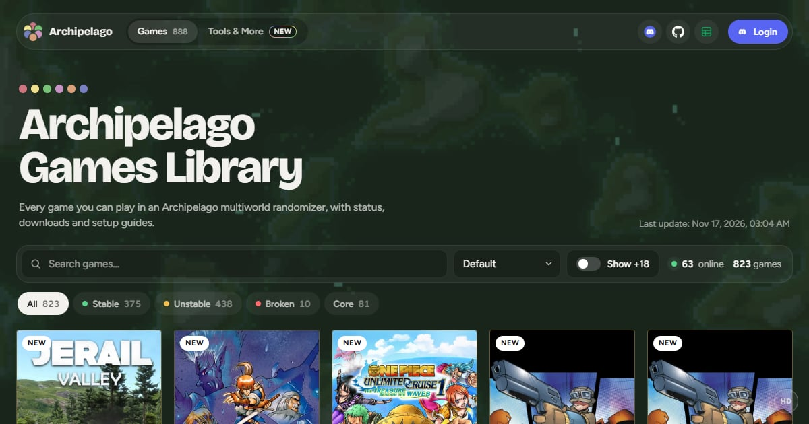

# Archipelago Games Library

A searchable list of every game you can play with [Archipelago](https://archipelago.gg), the multiworld randomizer.

**[mk-404.github.io/Archipelago-Games-Library](https://mk-404.github.io/Archipelago-Games-Library/)**




## What's in it

- Every game from the community spreadsheet, with its status (Stable, Unstable, Broken), download links, setup guides and support threads
- Core games and the ones currently in review
- A separate page for tools, trackers, meta games and hint games
- Search, filters and sorting by name, date added, status or votes
- Log in with Discord to save favorites and vote for the games you like
- 18+ games are hidden unless you turn them on

The data comes from the [Archipelago games spreadsheet](https://docs.google.com/spreadsheets/d/1iuzDTOAvdoNe8Ne8i461qGNucg5OuEoF-Ikqs8aUQZw) and the site rebuilds itself every 4 hours, so new games show up on their own. Covers and banners come from [SteamGridDB](https://www.steamgriddb.com).

## Wrong or missing cover?

Open the game on the site and click **Suggest a better cover or banner**. It opens an issue where you can drop the image. Once it's approved it goes live automatically.

Anything else wrong with a game (status, links, name) should be fixed in the spreadsheet, not here.

## Running it locally

```bash
npm install
npm run build   # downloads the spreadsheet and builds data/games.json
npm run serve   # http://localhost:8080
```

The build works without API keys. With `STEAMGRIDDB_API_KEY` it also downloads covers for new games, and with `GOOGLE_SHEETS_API_KEY` it can read cells that contain more than one link.

## Credits

Not affiliated with the Archipelago team. Game data is maintained by the Archipelago community, covers belong to their respective owners.
